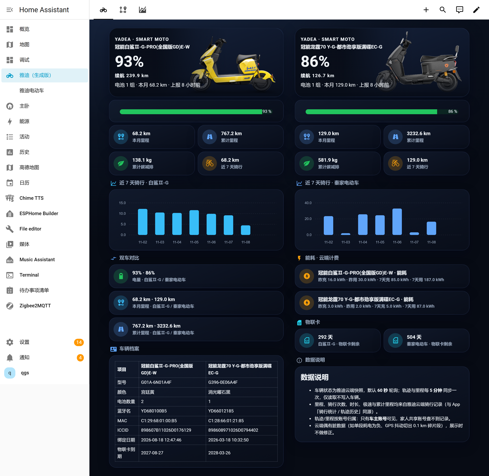

# Yadea dashboard（雅迪电动车仪表盘）

为 [ha-yadea](https://github.com/flyqgs/ha-yadea)（雅迪智行集成）打造的可安装仪表盘。
安装后**无需手写 YAML**：自动发现家中的雅迪车辆，生成三套统一深色风格的视图。



## 功能

| 视图 | 内容 |
|---|---|
| 总览 | 车辆实拍图头卡、电量长条图、电量趋势（近 7 天面积图）、本月/累计/减碳/近 7 天统计、近 7 天柱状图、双车对比、能耗·云端计费、物联网卡剩余、车辆档案对照表、数据说明（与旗舰版布局一致） |
| 骑行轨迹 | 今日里程大数字、近 14 天柱状图、最近路线起终点、今日分段明细表 |
| 能耗档案 | 昨日/7 天充电与耗电、车辆档案（型号/电池/物联网卡） |

- **自动发现车辆**：按雅迪集成生成的实体自动识别车辆数量与名称，一台或多台都适配
- **双车对称布局**：每台车独占一列，卡片一一对应；行数可变的分段表放在列尾
- **可自由定制**：仪表盘右上角「⋮ → 接管控制」即可把生成结果转为可编辑的普通仪表盘
- **显式指定**（可选）：不想自动发现时，可在策略配置里指定实体前缀：

```yaml
strategy:
  type: custom:yadea
  title: 雅迪电动车
  # show_data: false        # 不生成「能耗档案」视图
  # vehicles:
  #   - prefix: sensor.my_bike
  #     name: 我的电动车
  #     accent: "#f97316"
```

## 安装

### 前置依赖

| 组件 | 用途 |
|---|---|
| [ha-yadea](https://github.com/flyqgs/ha-yadea) 集成（v2.0.0+） | 提供里程/轨迹实体 |
| [card-mod](https://github.com/thomasloven/lovelace-card-mod) | 深色卡片样式 |
| [mushroom](https://github.com/piitaya/lovelace-mushroom) | 统计卡片 |
| [apexcharts-card](https://github.com/RomRider/apexcharts-card) | 近 14 天柱状图 |
| [bar-card](https://github.com/custom-cards/bar-card)（可选） | 总览页电量长条图；未安装时自动降级为普通电量卡片 |

以上均可在 HACS / Marketplace 安装。

### 本仪表盘

1. 在 **HACS → 前端**（或 HA 2026.11+ 的 Marketplace）搜索 **Yadea dashboard** 安装；
   也可通过「自定义仓库」添加本仓库地址（类别选 **Lovelace**）
2. 打开 **编辑仪表盘 → 添加仪表盘**，在 **社区仪表盘** 里选择 **雅迪电动车**
3. 完成——仪表盘会按你家里的雅迪车辆自动生成

> 如果在社区仪表盘列表里看不到，说明浏览器还没加载到本模块：强制刷新一次（Ctrl+F5）。

## 故障排查

**报错 `Timeout waiting for strategy element ll-strategy-dashboard-yadea to be registered`**

这是浏览器没有加载到（或缓存了旧版）策略模块，HA 侧本身正常。按顺序尝试：

1. **强制刷新页面**（Ctrl+F5；手机 App 在设置里清除前端缓存或杀掉重开）
2. 若装在 `config/www/community/yadea-dashboard/`，确认资源 URL 带版本号：
   「设置 → 仪表盘 → 资源」中把该资源的 URL 改为
   `/local/community/yadea-dashboard/yadea-dashboard.js?v=1.1.1`（版本号随更新递增）
3. 仍不行时重启 HA，再刷新浏览器

模块加载成功后，浏览器控制台会输出 `YADEA-DASHBOARD v1.1.1`，可据此确认版本。

## 里程/轨迹数据说明

- 里程、骑行次数、时长、极速均来自雅迪云端骑行记录（与 App「骑行统计 / 轨迹历史」同源）
- 轨迹/里程按账号归属：只有**车主账号**可见，家人共享账号查不到记录
- 雅迪为单会话体系：HA 登录会顶掉手机 App，反之亦然（详见 ha-yadea 集成说明）

## 许可

MIT
